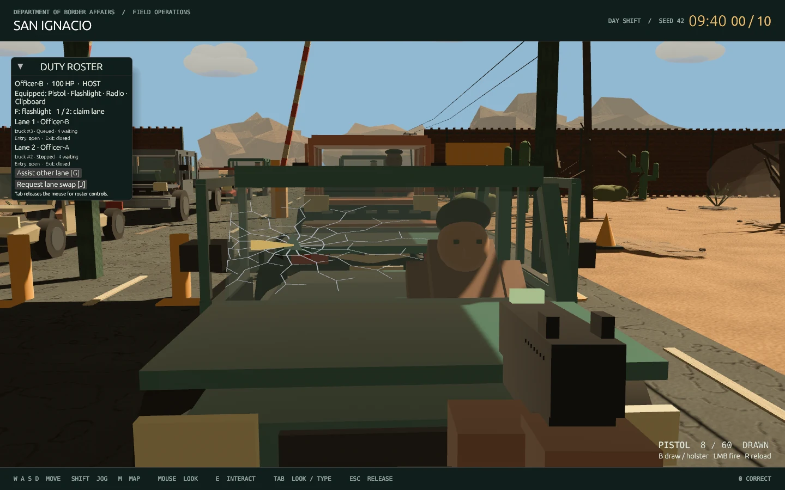

# Projectile pistol, interactive glazing and physical travelers

This update extends the two-lane prototype with a host-simulated pistol, working front doors and side windows, destructible glazing, and travelers who can leave their seats or die inside/outside the vehicle. Run the existing launcher:

```sh
./play.sh
# Second player, before ready-up:
./play.sh --join --name=Officer-B
```

## Controls

| Input | Action |
| --- | --- |
| B | Draw / holster the pistol after ready-up |
| Left click, with mouse look captured | Fire one projectile; click again for the next shot |
| R | Reload |
| E, aimed at a nearby outlined front door | Open / close that door (Q remains a shortcut) |
| V, near either front door | Lower / raise its front side window |
| Shift + V | Lower / raise that side's rear window |
| X, near the driver's side of your assigned/assisted lane | Order the traveler out; press again once outside to return them to their seat |
| T near a driverless vehicle, or E on the seated lane porter | Call the porter to remove the occupant if needed, drive to recovery and return |
| E / hold E | Talk or use the outlined object / grip a body until released |
| Escape / Tab | Close a panel / release or recapture mouse look |

The first click used to capture the mouse does not fire. UI clicks do not fire. A pistol is included in every officer's starting equipment. Weapons stay holstered in the pre-shift lobby. Normal play shows a small reticle; Tab opens the optional clipboard. Sound effects honor the dialogue/effects mute option; recording and all audio are disabled by automated graphical checks.

## Pistol and impacts

The pistol has a 12-round magazine, 60 reserve rounds, a 1.5-second reload and a minimum 220 ms firing interval. It fires finite-speed projectiles at 95 m/s with slight gravity. The host sweeps each movement segment against world solids, vehicle shell pieces, articulated doors, exposed glass, occupants and other officers. It uses the officer's actual position as the origin. Clients send only aim direction, never a victim, damage value or impact point.

The first-person model has hands/sleeves, frame, grip, slide serrations, sights, muzzle flash, recoil and a moving slide. Travelling rounds and short impact trails give visible feedback even for a close hit that resolves between two network snapshots. Original procedurally synthesized pistol/glass WAV effects use the existing ffplay dependency; `python3 scripts/generate_sfx.py` reproduces them. Effects playback runs outside the render thread.

Bodywork and world structures stop rounds. Glass reduces the remaining projectile energy to 70%; the same round can continue into the occupant. NPC body/head damage uses separate volumes and is applied by the host. Friendly fire also reduces the other officer's health. At zero health an officer cannot move, fire or interact; the host can still reset an expired shift and restore the crew. Threats and traveler injuries now incur shared misconduct penalties; complete spectator and nonlethal systems remain later roadmap work.

## Windows, doors and breakage

Both sedans and pickups have six individually tracked panes: windshield, rear glass, and front/rear glass on each side. Windows start raised. A seated traveler lowers the driver window when an officer approaches, then raises it when everyone leaves. Side windows slide into their doors; the exposed portion is also the collision surface. Broken windows cannot be rolled back into existence. Windshields and rear glass are fixed.

Both front doors have a moving outer panel, interior trim, armrest, handle, seals and upper frame. Front side glass follows its own door hinge while raised/lowered. Open door panels block movement at their actual angles; projectiles test the moving panel, upper frame and exposed glass, allowing shots through an open doorway. Player vehicle entry is not implemented. Front doors can be opened or closed independently of the driver being alive. The hood, trunk/tailgate and physical inspection findings from Part 6 remain available.

Side panes shatter on a hit. Windshield/rear glass first develops a jagged hole, branching radial cracks and a fracture ring; a second impact elsewhere removes the remaining pane. Later rounds through the first hole pass through it. The host and renderer use the same removed triangle cells, so a visible hole does not retain a whole-pane collider. Fracture state persists in snapshots for both officers until shift reset. Deterministic glass fragments tumble, fall, bounce and disappear after a short lifetime; metal/world impacts leave temporary marks and sparks. This uses bounded visual debris rather than a separate rigid-body simulation for every shard.

## Travelers and lane recovery

The seated driver is a separate articulated character, with head, face, torso, arms and legs rather than permanent pieces baked into the car mesh. X opens the driver's door, animates an exit and places the living traveler beside it. Conversation can then be reopened by approaching/aiming at the traveler. X returns them to their seat and closes the door. These physical orders currently use deterministic compliance; personality-dependent refusal and voice-command interpretation are separate future behavior work.

A vehicle cannot depart with an empty or dead driver's seat. Killed travelers now use the [constrained ragdoll skeleton](PHYSICS.md), with seat restraints in the cabin and physical collapse outside. Dead travelers stop answering and their cases reject further AI output. Their vehicles remain disabled in the queue until recovery, rather than driving away by themselves. Recovery grants no disposition reward and does not count as a correctly processed case. At time expiry the host can return everyone to the office, clearing damage/debris and restoring health and ammunition.

## Validation

```sh
cargo test --locked --workspace
cargo clippy --locked --workspace --all-targets -- -D warnings
cargo fmt --all -- --check
python3 scripts/test_host.py
python3 scripts/test_graphical_shift.py --lifecycle
python3 scripts/test_graphical_shift.py --combat
```

The final Rust suite passes **57 tests**, with one existing microphone/model fixture ignored. Clippy, formatting, the two-peer HTTP regression, and both graphical acceptance modes pass. Simulation coverage includes finite travel time, authoritative origin/damage, rate limiting, reload/ammunition, glass penetration/holes, body/world obstruction, raised/lowered and hinged panes, seated and outside deaths, NPC exit/return, disabled-queue recovery, friendly damage and reset by an incapacitated host. The combat desktop check runs two actual clients: both raise and shoot their driver-side glass, one kills a seated driver and demonstrates windshield cracks/removal, and the other orders its traveler out and kills them outside. It uses an offline gateway and disables microphone/audio. Existing lane, inspection and conversation checks remain separate regressions. Windows desktop operation and reference RTX 2060 performance remain unverified.



The [movement/physics update](PHYSICS.md) supersedes the earlier particle/death-pose implementation with Rapier shards, eleven-body ragdolls, body extraction, right-button aiming, layered transparency and six vehicle types. It also removes the duplicate impact trail.

The [casual conversation and psychology update](CONVERSATION.md) supersedes the original timed recovery, automatic interview panel and control descriptions above.
