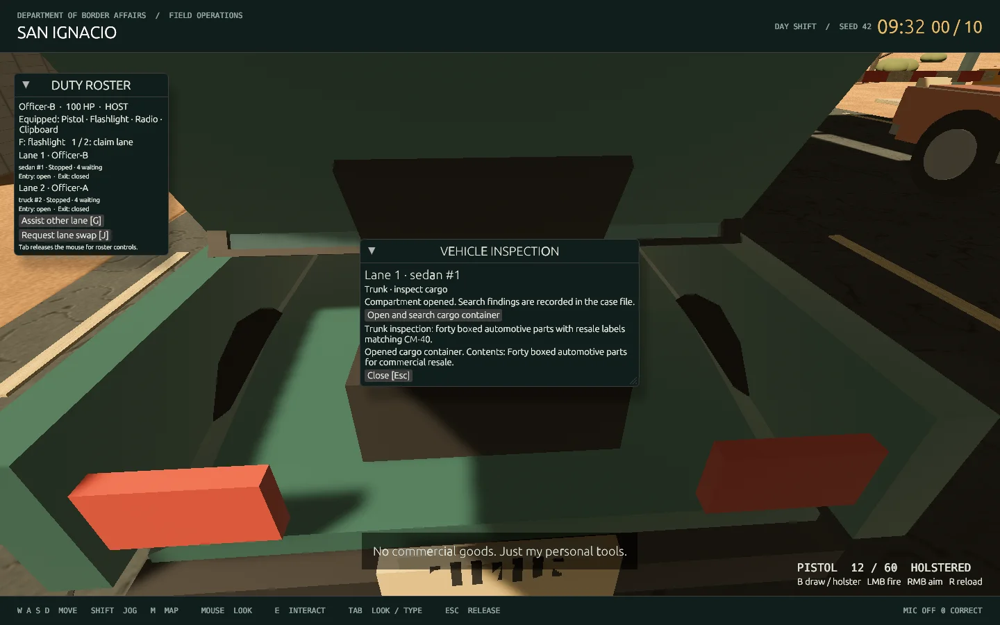

# Parts 7–10: cases, conversation, local voice and physical evidence

Run `./play.sh` from the repository folder. A second officer joins with `./play.sh --join --name=Officer-B` before ready-up. Gemini 2.5 Flash Lite remains the configured hosted actor; Whisper Large-v3 Turbo and Kokoro-82M remain the resident local speech models. No additional paid service is required.

## Cases fixed before conversation

`assets/case_templates.json` defines ten compatible occupation/reason/cargo archetypes. The case files contain seven honest travelers and three smugglers, canonical document fields, initial declarations, biographies, authority boundaries, evidence locations and contradiction links. The loader rejects duplicate names, IDs/seeds, incompatible combinations, mismatched canonical document fields and invalid references/reveal rules.

Each host-spawned traveler receives a record seed derived from the session seed, shift epoch, vehicle ID and authored seed. Four mannerisms, five interests and four stress responses provide a small 80-combination personality proof of concept. This variation changes conversational texture; it never rerolls guilt, cargo, itinerary, documents or evidence. A fixed seed and shift produce the same record. The full procedural library remains Part 18.

| Traveler | Character and boundaries |
| --- | --- |
| Mara Bell | Enthusiastic photographer; eager to cooperate, easily flustered |
| Nadia Ortiz | Exhausted nurse; abrupt, sarcastic and practical |
| Victor Hale | Polished antiques dealer; charming, evasive and willing to bargain |
| Evelyn Park | Warm retired librarian; meandering, patient and principled |
| Leo Singh | Playful musician; theatrical, impatient with delays |
| Dorian Pike | Blunt delivery contractor; rehearsed account and short temper |
| Amir Chen | Anxious student; becomes precise with clear questions |
| Rosa Kim | Protective dog trainer; dry humor and strong resistance to bullying |
| Cal Mercer | Cocky mechanic; opportunistic, minimizing and quick with excuses |
| Priya Das | Witty food blogger; curious, cutting when patronized and principled |

Bribery-capable characters can make verbal offers. Financial transfers, resistance, cuffs and a full arrest sequence remain later work. Hostility, anxiety and cooperation do not establish guilt.

## Trusted conversational actor

The gateway supplies the actor with its character, immutable knowledge, cover account, observed evidence and ordered dialogue. The opening and every accepted turn remain separate conversation messages; history is bounded at 128 turns rather than silently truncated. The host independently checks turn order, shift epoch, output schema and permitted fact IDs before appending a reply.

Frustration, confidence, suspicion and cooperation evolve by replaying accepted officer utterances and traveler emotions. Apologies can repair cooperation; repeated abuse can increase frustration. These scores describe the traveler's reaction, not a guilt estimate. Personality variation, verbal compliance boundaries, unknown details, sarcasm, accusations and optional refusal/confession are covered in the actor instructions.

Normalized duplicate dialogue is rejected across the last four replies, with an exception for an explicitly requested echo. Semantic similarity is measured during evaluation rather than automatically rejecting a legitimate repeated factual answer. The offline actor remains visibly labeled **offline rehearsal**; it is not presented as an LLM.

Provider credentials stay in the caller service. No model reply can modify evidence, money, guilt, a disposition or vehicle movement. Free-form spoken claims remain untrusted: schema validation is not a semantic proof of every sentence. An unavailable or malformed response produces the neutral spoken fallback “Excuse me?”, tagged as a delivery failure with no evidence or gameplay action. HTTP 429 starts a bounded provider cooldown. The conversation remains available for the next spoken question.

## Local voice and client isolation

Each client owns microphone capture, segmentation, transcription requests, playback and subtitles. Local clients on the same PC may share the resident model process; audio capture and playback remain client-owned. A remote joining PC runs its own local models. Speech inference, HTTP and playback run off the render thread.

The microphone continuously listens during an in-range interview, pauses during traveler playback and sends after **1.5 seconds of silence**, with a **20-second maximum**. Typed input is always available. Leaving/resetting a case, muting or receiving a shared disposition cancels that case's playback. A completed inference from an old case cannot begin stale audio playback. Playback cancellation is separate for each client.

Linux capture uses ALSA. Windows typed play remains available; Windows microphone capture, spatial speech and physical microphone/speaker playtesting remain acceptance work. No RTX 2060 frame-rate certification is claimed.

## Physical searches and decisions

1. At the driver, press **E**. The recorded declaration and presented documents enter the shared evidence file.
2. **Request secondary inspection** marks the case and returns mouse control. It does not reveal cargo remotely.
3. Walk to the passenger door, press **E**, then open/search the glove compartment in its inspection window.
4. Walk to the rear cargo point and press **E**. The trunk or tailgate opens and its cargo finding is recorded. Open/search the cargo container there for its separate finding and hinged lid.
5. Utility pickups have a connected small trailer, wheels, drawbar and secured container. Walk behind the trailer and press **E** to inspect its inventory. The larger collision/queue envelope includes the trailer.
6. Return to the driver to question further or choose **Admit**, **Deny** or **Detain**. Both officers see recorded evidence, location, source ID and links to conflicting declarations. Unsearched findings do not enter the actor's observed-evidence context.

Every search checks vehicle stage, lane ownership/assistance, physical range and opening conditions. Knowing an evidence ID cannot bypass those checks. Repeating a search does not duplicate observations/events. A hood check grants engine-bay access rather than magically establishing cargo status.

The host resolves from the fixed truth, once per vehicle. Correct admission pays 100; admitting a smuggler costs 400. A supported correct denial pays 200; an unsupported lucky denial pays zero. Incorrect denial costs 150. Detention requires recorded contradictory evidence and pays 250 for a correct supported outcome. A spoken confession alone cannot satisfy that evidence gate. The debrief lists specific missed findings. Admitted vehicles continue north; denied/detained cases leave via the controlled return route, with detention treated as an impound disposition. Full physical custody/escort animation belongs to Part 11.

## Validation

- 72 passing Rust tests, one existing physical-microphone fixture ignored; Clippy and formatting pass.
- All ten cases can be resolved correctly through physical evidence with no confession or dialogue required. Tests cover unauthorized/remote searches, opening conditions, observation filtering, immutable truth, detention support, decision replay and departure.
- Two real graphical clients complete sedan/truck cargo and container searches with shared observations and an animated compartment lid.
- Real Rust adapters transcribe generated speech, accept a 20-second utterance and synthesize both Kokoro voices. Speech service boundary tests verify authentication and request handling.
- The current live Gemini intent report and resource measurements are recorded alongside this document in `parts-7-10-validation.json`. The live intent sample obtained **20 validated replies** across resumed runs after upstream HTTP 429 rate limits (median successful request 0.62 s). [The complete sample](parts-7-10-intent.json) includes the initial Cal exchange used to reproduce the original follow-up issue. A rate-limited request remains a failure until a real retry succeeds; offline answers are never substituted.

Measured on this RTX 3080 / six-core Ryzen 5 3600 machine: at 1920×1080 with resident speech, peak combined process RSS was **2790.6 MiB** and incremental whole-device GPU use was **2603 MiB**. The speech adapter check reported **1954 MiB** for the speech process. These fit the selected 16 GiB RAM / 6 GiB VRAM resource budgets; they do not establish RTX 2060 frame rate or a final hardware minimum.

```bash
cargo test --locked --workspace
cargo clippy --locked --workspace --all-targets -- -D warnings
python3 scripts/test_host.py
python3 scripts/test_graphical_shift.py --lifecycle
python3 scripts/test_speech_service.py
python3 scripts/smoke_gpu_speech.py
python3 scripts/benchmark_reference_runtime.py
# Uses the configured paid API; build the prompt exporter first.
cargo build -p border-caller --example prompt_messages
python3 scripts/benchmark_intent.py --variant current --models google/gemini-2.5-flash-lite
python3 scripts/benchmark_intent.py --variant current --models google/gemini-2.5-flash-lite --resume
```



See [current casual interactions and psychology](CONVERSATION.md) for exclusive initiating officers, optional UI, windows, body grips, porters and the latest validation.
