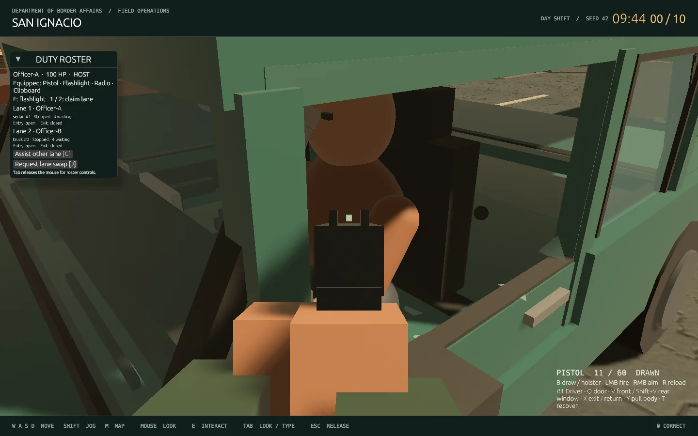
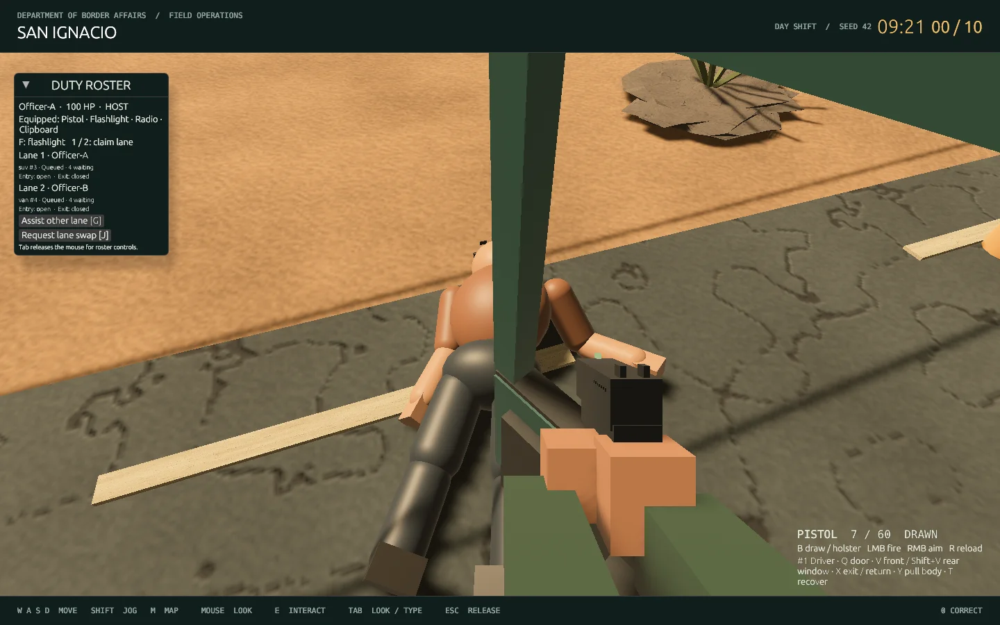
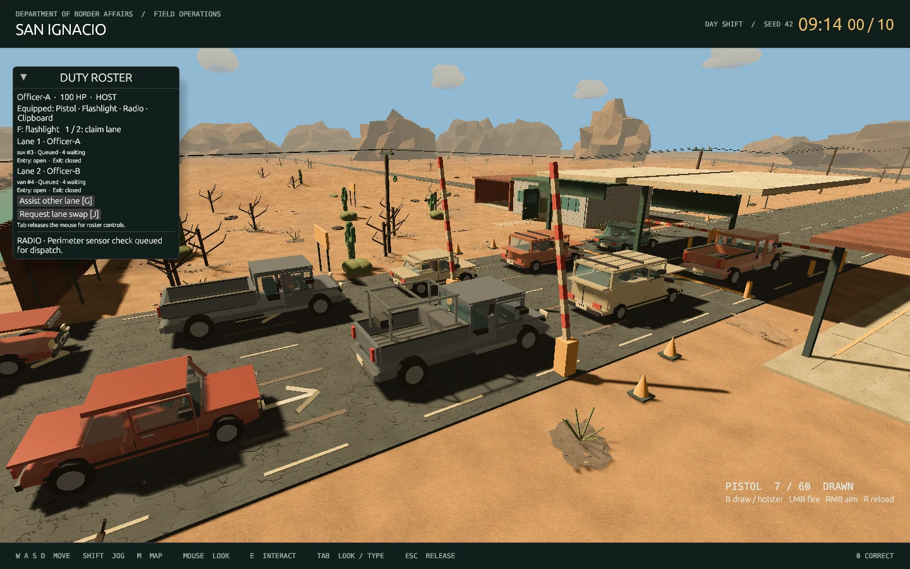

# Movement, aiming, articulated bodies and vehicle variety

Run `./play.sh`; a second officer joins with `./play.sh --join`. The office ready hold is now **two seconds**. Two lanes and the existing ten travelers remain.

## Movement and weapon fixes

Player translation previously followed successive host snapshots, which made movement arrive in visible steps. Normal play now predicts walking/jogging every rendered frame, using the **same collision function** as the host (`crates/net/src/movement.rs`). Small network differences are reconciled gradually; shift respawns and large corrections reset the predicted pose. When standing still the camera converges to the authoritative position for accurate interaction/aiming. Prediction pauses if snapshots become stale. Positions, readiness, damage and rewards remain host-owned.

The graphical worker now sends input/receives snapshots at 20 Hz, matching the host tick. Vehicle roots and remote officers are interpolated, and vehicle glazing, doors and seated occupants use the displayed car pose together so a driver does not jump ahead of an interpolated car.

Hold **right mouse** with the pistol drawn to aim down the sights. Sight alignment, field of view (70° hip / 50° aimed) and gun placement blend smoothly; aiming reduces mouse sensitivity. The sight posts have been resized to keep the target readable. Right click can also capture mouse look. B draws/holsters, left click fires, and R reloads.

The doubled bullet appearance came from rendering both the travelling projectile and another full-length trail after impact. The impact trail is removed. Each shot now has one moving tracer, with impact-only marks/debris and the existing host-simulated travel/collision.

## Physical glass and transparency

Glass fragments are actual **Rapier rigid bodies on the host**. Thin colliders receive gravity, angular velocity, friction, restitution and continuous collision detection. They collide with the road, cabin, seats, vehicle bodywork, doors and intact glass. Full breakage releases fragments across the pane; a windshield hole releases a smaller burst. There are at most 256 live fragments; they expire after eight seconds. Fragment-to-fragment contacts are filtered to control cost.

Clients display replicated fragment transforms with smoothing. The old upward-only glass particle burst is disabled. Metal/world impact sparks remain short visual effects.

The camera uses Bevy's **order-independent transparency** with 16 layers and MSAA disabled. This handles overlapping transparent panes and shards without treating the first pane as the only visible glass layer. Both faces of the glazing are rendered. This is alpha-blended glass rather than a refraction renderer.

## Cabin ragdolls and extraction

The living, seated and dead characters now share one **fixed-length, eleven-bone skeleton** (`crates/net/src/rig.rs`). Physics and rendering use the same bone centers, orientations and lengths. Rounded sleeves, skin and trouser sections overlap at their joints, with attached hands, boots and a head. Ragdoll bones are rendered from the same authoritative snapshot without independently smoothing each bone, which previously made the visible joints separate during rotations.

The pelvis/chest joint has its own narrow limits: about 13° backward / 17° forward, and 9° sideways/twist. The neck, shoulders and hips have separate ranges. Elbows bend in one direction; knees bend in the opposite direction, with side rotation locked and almost no backward extension. Masses are distributed across the torso and limbs. Passive spring/damping resists motion without making an unconscious character hold an upright pose. These are game constraints representing bones and soft-tissue resistance; there is no anatomical tendon or muscle simulation.

The host simulates the bodies and glass at **120 Hz**, with extra joint solver and stabilization iterations. A seated body fits below the roof and retains a releasable seat restraint. Standing bodies fall under the same solver. Shots can impart impulses to individual bones.

Near the **driver's side**, press **Y** or use **Pull body out** in the duty roster. The host checks range and lane ownership/assistance, opens the door, lowers the driver glass and releases the seat restraint. A temporary **force-limited spring at the shoulder** pulls the body out, allowing the torso to rotate through the opening. The target stays higher until the pelvis clears the sill; pickup/SUV/van height is accounted for. The target pauses if the grip falls behind. Once the pull finishes, the spring releases and the body settles under gravity. It does not teleport to a preselected prone pose. X orders a living traveler out/back; T requests recovery of a disabled vehicle.

## Connected vehicle assemblies

Doors, glass and window seals are actual children of each moving vehicle root. Door mirrors and their mounting stalks belong to the hinged door, so they follow it when it opens. Front side glazing now lies in its frame instead of floating inward from it. Fixed panes have perimeter seals.

Shared structural boxes define connected roofs, full-height pillars, rockers, engine-bay sides, quarter panels and the front fascia for all six body types. The renderer and host collision use these same pieces. Hood widths match their body, and the pickup bulkhead joins the chassis below its rear glass. This fills the previous gaps between the lowered chassis, lamps, hood, pillars and roof while preserving the door openings.

## Six detailed vehicle bodies

| Kind | Distinguishing body/fittings |
| --- | --- |
| Sedan | Existing chamfered body, sloping glazing and short trunk |
| Pickup | Raised cab, open ribbed bed, running boards and larger wheels |
| SUV | Longer raised passenger roof, extended rear glazing and roof rails |
| Van | Longer/taller body, large rear side glazing, roof ribs and rear door detail |
| Hatchback | Shorter wheelbase/body, rear lip spoiler and rear wiper |
| Utility pickup | Pickup bed with metal toolbox and elevated cargo rack |

All types have close-up grille slats, plate characters, lamps, bumpers, hood/door seams, wipers, sills, fuel covers, dashboard/radio fittings, vents and steering-wheel detail. Paint and body variants remain independent of scenario guilt. Catalog dimensions drive queue spacing, access points and collision. Both lanes receive mixed types. Front doors/windows and existing hood/cargo inspections remain usable; this is a reusable procedural vehicle set, not a scan-quality asset pack.

## Reuse and validation

The implementation integrates Rapier and adapts its articulated-body example, plus Rusty Shooter's weapon offset/recovery pattern. [Pinned sources, modifications and retained license notices](THIRD_PARTY.md) are included.

```sh
cargo test --locked --workspace
cargo clippy --locked --workspace --all-targets -- -D warnings
cargo fmt --all -- --check
python3 scripts/test_host.py
python3 scripts/test_graphical_shift.py --lifecycle
python3 scripts/test_graphical_shift.py --physics
```

The locked workspace suite passes **62 Rust tests**, with one existing microphone/model fixture ignored. Clippy, formatting, the HTTP regression and the two-client physics acceptance check pass. Tests cover smooth bounded prediction/reconciliation, the two-second host hold, the existing ten-minute clock and interviews, all vehicle types/queue paths, finite falling/colliding fragments and expiry, joint anchor separation under 3.5 cm, bounded spine rotation, knee/elbow limits and twisting, seat restraint, physical extraction and projectile impulses. The stress check covers seated and standing bodies at two vehicle angles for every body type, checking every simulation step. A structural connectivity check verifies that every shared shell piece connects back to the chassis across all six vehicle types. The physics graphical check runs two actual clients, captures right-button aiming, glass breakage, cabin/outside ragdolls and extraction, and verifies all six vehicle kinds. Automated checks use offline AI and disable recording/audio. A human feel/performance review and RTX 2060 hardware certification remain outside these automated checks.






