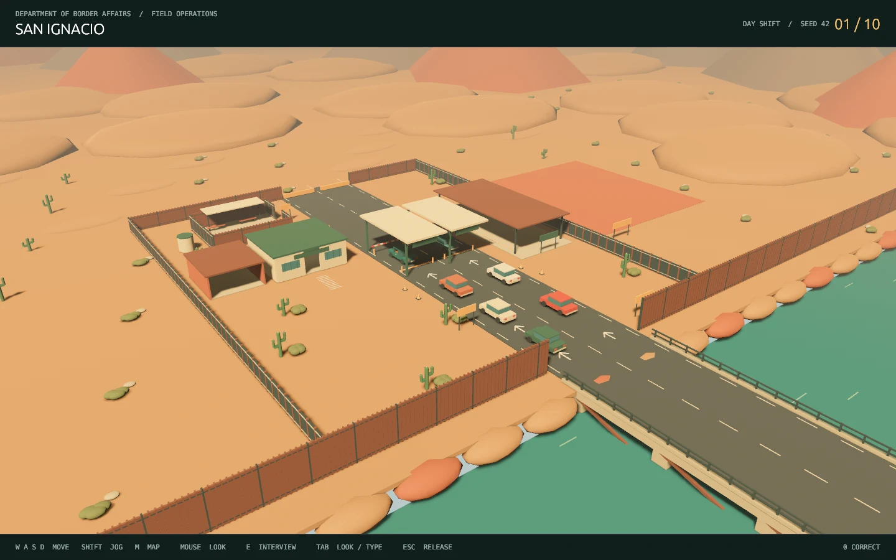

# Running the current Border Patrol with Friends prototype

Run terminal commands in this guide from the repository root. This guide describes the current prototype; the [technical build roadmap](../README.md) describes the complete target game.

A Rust / Bevy first-person checkpoint prototype. Interview ten fictional travelers at **San Ignacio, a fictional border crossing in Texas**, compare their accounts with documents and cargo, and decide who crosses. Exactly seven honest travelers and three smugglers. Built from primitive meshes; no art downloads required.



The expanded [Part 4 scene](SCENE.md) includes a river bridge, Texas-bank fence, two lanes, an enterable office, storage, holding yard and secondary bay. Cars now approach over time, queue, stop for interview and drive away after processing. The roads bend into a rough, rocky desert with detailed surface textures, scrub, clouds and dust. Press **M** for the site map; hold **left Shift** to jog.

## Launch from a terminal

Linux / Fedora:

```bash
./play.sh
```

Windows PowerShell:

```powershell
.\play.ps1
```

First launch compiles the game, authoritative host and local interview service. Subsequent launches reuse the build. Rustup installs the pinned Rust 1.94.0 toolchain. Install Rust from https://rustup.rs if needed. Linux needs a C compiler, X11/XWayland and Vulkan-capable graphics drivers; Fedora development prerequisites are `gcc gcc-c++ make libX11-devel libxkbcommon-devel`. Windows needs the Visual Studio C++ build tools and Vulkan/DirectX drivers. Linux launcher also uses Python 3 and curl. Windows launcher uses PowerShell directly.

Choose a reproducible shift order: `./play.sh --seed=123`. Services default to loopback, and the hosting launcher stops them when its game closes. Logs: `output/host.log` and `output/caller-server.log`. Change `BORDER_HOST_PORT` / `BORDER_PORT` if 8090 / 3847 is occupied. Launch from any directory using the full script path.

For a second local player, run `./play.sh --join --name=Officer-B` in another terminal **before ready-up**. Windows: `.\play.ps1 --join --name=Officer-B`. [Part 5](SHIFT.md) explains LAN joining and the two-player session contract.

## How to play

1. Spawn in the shared office, healed and equipped. Click the scene to look and use WASD to approach its closed exit door.
2. Hold **E for three seconds**. The host can start, or a strict majority can register ready. The door opens and the shared ten-minute clock, queues and radio/security hooks begin.
3. Claim a lane with **1/2**; use **J** for a consented swap and **G** to assist the other lane. **F** toggles your flashlight. The roster also offers these controls after releasing the mouse with Tab.
4. Aim at a stopped car within 3 meters and press **E** to interview. Both officers share the same host-owned conversation and evidence when assisting.
5. Speak normally: automatic listening sends your question after a pause. You may also type and send or press Enter. Inspect documents/cargo and compare the account against evidence.
6. Choose **Admit** or **Deny**. The host commits the result once. **Close file & call next car** releases that vehicle while the other lane continues independently.
7. At zero, finish already stopped drivers; fresh arrivals pause. The host can prepare another shift, returning officers to the closed office lobby. See [Part 5](SHIFT.md) for the complete start/expiry/reset behavior.

**Tab** switches mouse look / typing while the interview stays open. **Esc** closes the overlay and releases the pointer; aim and E resumes the same case. Click the scene to capture the mouse. No interview ends automatically. Live spoken compliance is character-specific: opportunistic or eager travelers can repeat a false denial to get through; principled or defiant travelers can refuse. These words never change physical evidence or guilt. Repeated and irrelevant questions change the actor's reaction; nervousness does not indicate guilt.

## AI modes

The default is clearly labeled **offline rehearsal**: authored topic responses with personality, repetition reactions and evidence-gated admissions. It is deterministic and requires no API key. It is useful for testing the complete gameplay loop, but does not understand arbitrary language like a live LLM.

For natural AI conversation on Linux, copy `.env.example` to `.env`, then configure:

```bash
OPENROUTER_API_KEY='your-key'
OPENROUTER_MODEL='google/gemini-2.5-flash-lite'
```

On Windows set those environment variables in PowerShell before running the launcher. Choose an available Qwen/Gemini or other OpenRouter model and benchmark character quality/latency; no model is silently selected or paid request made without your configuration. Optional input/output USD rates enable estimated cost logs (zero means no rate configured). A process cap defaults to 120 provider attempts including repairs; cases allow 40 turn attempts each and keep all successful turns. Provider requests time out at 10 seconds, with at most one contract repair. The configured local setup uses **Gemini 2.5 Flash-Lite**, as requested. The dialogue-context improvements remain enabled. A controlled comparison ran the same 20 officer utterances through Flash-Lite, Flash and GPT-4.1 mini with both the old and revised conversation context. Flash handled references, clarification and reactions more reliably than Flash-Lite in those runs. See [measured results and limitations](INTENT_BENCHMARK.md). No model is guaranteed to avoid hallucinations.

The trusted server owns scenario truth, evidence disclosure, history and dispositions. The game process receives public case data, actor replies and committed debriefs. Launch scripts remove provider key/model variables from the game environment. HTTP jobs run on worker threads; service handlers are asynchronous. Invalid JSON, unknown/hidden fact IDs, unsupported actions and automatic hangups are rejected. **Structural validation cannot prove every natural-language sentence is true**: live models can still hallucinate or disclose an untagged fact. Test your chosen model before treating it as reliable gameplay. The prototype is a local development service, not a hardened public multiplayer backend.

## Voice (Linux)

Install local speech recognition once:

```bash
./scripts/setup-voice.sh
```

The default installed profile now uses **GPU Whisper Large-v3 Turbo** for recognition and **Kokoro-82M** for more natural speech. Both stay loaded in a local service. The engineering reference is **6 CPU cores, 16 GB RAM and an RTX 2060 with 6 GB VRAM**; the speech VRAM target is at most 3 GB, leaving headroom for the game. See [setup, measured results and hardware limits](SPEECH_MODELS.md).

Installation creates an isolated Python 3.11/CUDA environment and downloads the models once. It needs NVIDIA drivers, Python 3 venv, curl, `arecord` (Fedora `alsa-utils`) and `ffplay` (FFmpeg). It does not change system Python or require a C++ compiler for the default profile. The launcher discovers the installed service, waits for warm-up and cleans it up when the game closes.

For the previous CPU Tiny/Piper profile, use `BORDER_SPEECH_PROFILE=lightweight ./scripts/setup-voice.sh` and the same prefix with `./play.sh`.

**There is no push-to-talk.** After E starts an interview, the microphone stays active throughout that interview, even while you look around or close the overlay. Speech detection waits for 1.5 seconds of silence, transcribes the phrase locally, and sends it to the live AI automatically. Listening pauses while the AI thinks or the traveler speaks, then resumes; it stops when you commit a decision. Traveler replies play aloud by default. Headphones reduce echo. Silent audio and short clicks are not sent for transcription.

**Audio & controls** lets you turn the microphone off, mute the traveler, select the ALSA capture device (default `default`), and adjust the noise threshold. Click **Apply settings / retry microphone** after changing the device or threshold. Each utterance is capped at 20 seconds and recognition has a 30-second timeout. Replies use the resident Kokoro voices in the reference profile. The CPU profile still uses Piper; `./scripts/setup-tts.sh` installs its voices. The reference profile requires no paid speech API. Typed play works even if microphone/speech tools are absent.

Current voice limitations: capture supports Linux only; Windows supports typed play. Speech uses a persistent local GPU service (or external CPU tools) rather than CPAL/Rodio and is not yet spatialized at the driver window. Automatic phrase detection followed by local whisper.cpp transcription was verified with generated speech ("What is the purpose of your visit?"). Both GPU voice profiles were synthesized through the actual Rust/HTTP adapter and their WAV outputs verified locally. Microphone and speaker hardware still require a real playtest. CPAL device enumeration, Windows capture and spatial audio remain follow-up Phase 1 work.

## Development and validation

```bash
cargo test --locked --workspace
cargo clippy --locked --workspace --all-targets -- -D warnings
cargo fmt --all -- --check
cargo build --locked --workspace
python3 scripts/smoke_api.py
# Optional PAID live test: supply OPENROUTER_API_KEY and OPENROUTER_MODEL
python3 scripts/smoke_live.py
./play.sh --smoke-test
```

The API smoke test starts a temporary offline service on 13847, runs 30 exchanges per case, inspects evidence, commits all ten correct decisions, and tests auth/input/state/budget errors. The graphical smoke mode saves `output/checkpoint.png` then exits. `./play.sh --smoke-interview` also exercises an interview and secondary inspection, saving `output/interview.png` and `output/evidence.png` after the first car has arrived. It is a rendering smoke check, not a human playthrough. CI is configured for Linux and Windows; an actual Windows run is not yet verified.

Scenario data: `assets/scenarios/*.json`. Each contains personality, coherent immutable truth, initial cover stories for smugglers, document/cargo evidence, contradiction references and offline actor guidance. The live model receives only initial cover facts from the actor fields, not canned repetition/confession lines. The loader rejects malformed packs and requires exactly ten unique scenarios, three smugglers and fixed unique seeds. Unit tests run 300 authored exchanges and check disclosure/ground-truth invariants. See [design](DESIGN.md), [scenario contract](SCENARIO_SCHEMA.md), and [validation results](VALIDATION.md).

This is the initial playable slice, not the entire PDF Phase 1 acceptance. Sustained live model consistency, human playtesting, speech hardware, spatial audio and Windows execution still need verification. Two-client host play and the ready-up/clock loop are now connected. Full multiplayer acceptance/reconnect, player driving, combat, final economy and detailed physical searches remain later work. Inspired by the crate separation in [WrongNumber](https://github.com/ImadMashhood/WrongNumber); no reference project was modified.

Part 6: both lanes now receive sedans and pickups. Aim at a stopped vehicle's driver window to talk, or its passenger door, hood or rear cargo point to inspect using E. Physical cargo inspections share their findings with the other officer. [Vehicle controls and validation](VEHICLES.md).
