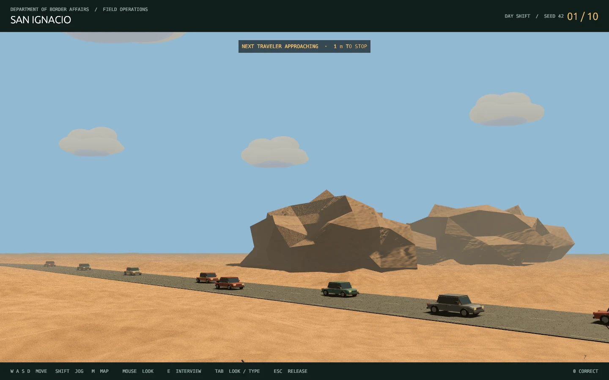
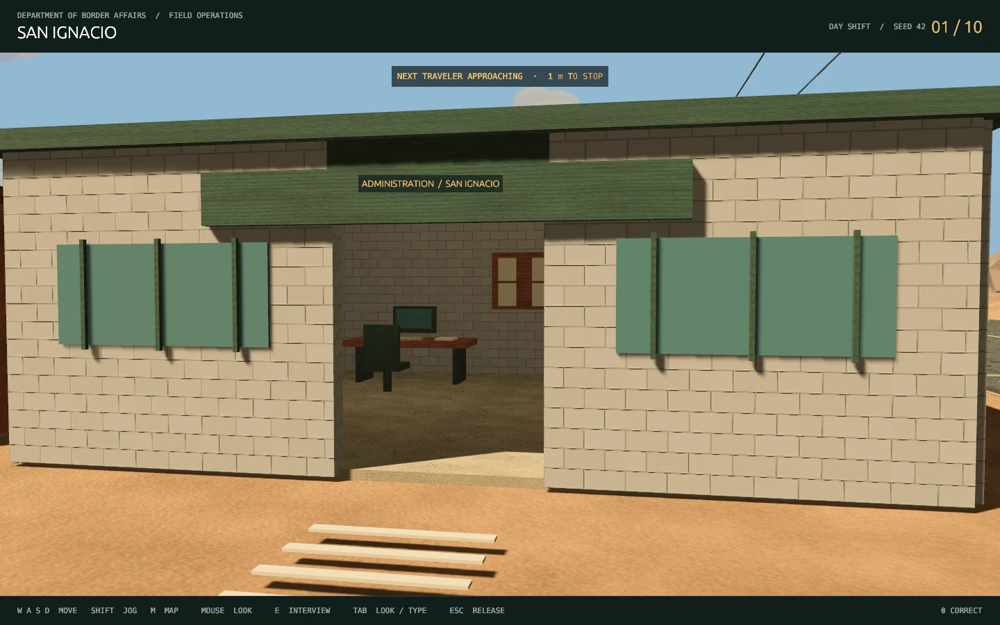
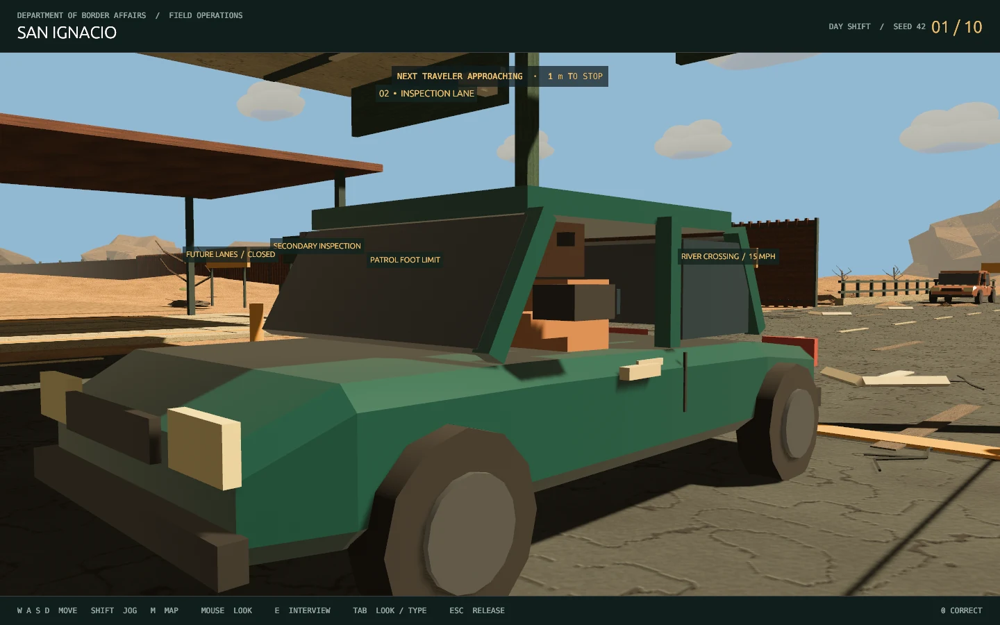

# San Ignacio environment and timed traffic

San Ignacio now sits on the Texas bank of a desert river. The road crosses a supported bridge into the checkpoint through an opening in the border fence. The long border fence stays on the Texas bank; it does not run down the opposite bank or through the water.








## Explore

Launch the updated graphical prototype with:

```sh
./play.sh
```

Complete the office ready hold, then use WASD and the mouse. Hold **left Shift** to jog. Press **M** for a site map with your position; press M again to close it. E interacts with the stopped vehicle’s driver window, passenger door, hood or cargo point within two metres of its access position. Tab switches between mouse look and typing, and Escape releases the mouse.

The administration office is west of the inspection lanes, storage is immediately farther west, the holding yard is behind the office, and secondary inspection is east of the lanes. The river bridge is south, behind the vehicle queue. Walk through the fence opening and across the bridge to the posted pedestrian limit. Vehicle roads continue beyond the walkable yard, bend into the rocky landscape and fade into haze. Posted signs mark the pedestrian limits; the compound itself is open, with no enclosure fencing; the surrounding desert and reserved future lanes are scenery.

## Scene inventory

| Space | Implemented detail |
| --- | --- |
| Two-lane checkpoint | Separate lane markings/arrows, stop lines, canopy beams, hanging fixtures, cameras, protective bollards, moving striped barriers and timed vehicle queues |
| Active interview stop | Ten mixed sedans and pickup trucks with clean varied automotive paint, visible drivers, vehicle-sized braking/queue spacing, four articulated inspection points, AI/text/voice conversation and shared evidence UI |
| Administration office | Clean textured cinderblock exterior with staggered courses, mortar grooves, subtle concrete pores and consistent block scale; hollow enterable room, doorway, window trim, roof, desks, terminals, chairs, documents, filing cabinets, bulletin board, coffee station, ceiling fixtures and warm interior lighting |
| Equipment storage | Open-front shelter, shelves, stacked crates, adjacent utility cabinet, service pipes, condensers and barrels |
| Holding yard | Open concrete pad with painted markings, shaded benches, nearby water tank and location sign; no surrounding fence |
| Secondary inspection | Broad marked concrete apron, open-sided roof, structural posts and work tables |
| River crossing | Separate riverbanks, lowered river channel, animated surface streaks, road deck, piers, guardrails, posts and diagonal supports |
| Border | Tall Texas-bank fence with a bridge opening, detailed close slats and inexpensive distant sections fading into haze |
| Desert | Ribbed cacti with spine clusters/flower tips, scrub and dead trees, loose twigs, scree, chipped angular rock variants, irregular sandy terrain, layered drifting clouds and dust plumes; no dunes |
| Readability | Clean car paint is separated from gritty road/terrain materials. Warm palette, directional shadows, distance fog, occluded location labels, humorous notices and site map; procedural grit, normal maps, fissures, stains, tire wear, concrete joints, rust, roof vents, roadside service poles and sagging wires |

The playable yard is approximately 64 × 73 metres, with an additional walkable bridge corridor. Compound fences have been removed; only the riverbank border wall remains. Bridge guardrails and traffic barriers stay in place. Movement stays at ground/deck level, with axis-aligned collision against structural walls and props. Enterable facilities and the driver approach are reachable from the spawn. Terrain outside the yard/bridge is intentionally non-navigable. The eastern reserved apron provides space for later expansion without adding operational lanes now.

Environment meshes and material handles are shared across repeated props and the vehicle pool. Rocks use seven deterministically deformed, chipped mesh variants; clouds use overlapping detailed lobes with baked cool shading. Small procedural albedo/normal maps add grit and surface variation to sand, concrete, asphalt, stone and metal; a dedicated masonry material gives the office readable block courses, while car paint stays clean without downloading texture packs. Terrain relief is strongest beyond developed areas, while walking routes and road beds stay clear and flat enough to navigate. This remains stylized art and has not been performance-certified on an RTX 2060.

Normal play now begins in the shared office with the [Part 5 ready-door and clock flow](SHIFT.md). The two lanes, moving vehicles, conversation/evidence and decisions are now host-owned rather than independent local traffic.

## Vehicle cadence

Queues remain inactive in the office lobby. After ready-up, five authored vehicles per lane approach in host-controlled order, brake to their stops and maintain queue gaps. Both clients render the same positions and barriers. Lane owners or assigned assistants can open the stopped traveler's interview.

After a committed decision, closing the case file asks the host to release the vehicle. Admitted cars follow the outbound bend; denied cars turn onto the west return road. The next car advances independently in that lane. Both lanes are now real cases, not one interactive lane plus ambient traffic. Exactly seven of the ten authored travelers are honest and three smuggle. Repeated requests cannot duplicate the ledger award.

The scene-preview renderer retains a local art-review traffic loop for deterministic captures; normal `./play.sh` uses the host session and clock.

## Scope boundary

The detailed scene and Part 5 shared-office/host session are connected. The office now has the working ready-up door. Work tables and crates remain props; trucks, physical search points, fuller detention behavior, final review/economy and complete multiplayer hardening stay in their later Parts. Current desktop co-op uses simple officer markers and shared state; the complete 20-step multiplayer acceptance run remains Part 15.

## Validation

Validated on Linux with Rust 1.94.0 and the locked dependency graph:

- Full workspace tests: **60 passed**, one existing explicit microphone/model fixture test ignored.
- Clippy for the entire workspace/all targets with warnings denied, plus Rust formatting: passed.
- A headless connectivity test builds the actual scene and flood-fills collision-free walking routes from spawn to the office, storage, holding yard, secondary bay, driver and both ends of the bridge. It also rejects river shortcuts and the reserved future lanes.
- `./play.sh --smoke-shift` passed with the resident GPU speech models loaded and a clean automatic exit.
- The local preview traffic system test runs all ten cases with alternating admit/deny decisions, checks queue gaps and the west return route, then restarts the shift. Other tests cover braking, the bridge/bent approach route and yielding to a person in the driving lane.
- Rendered views reviewed for the overview, normal driver position, rocky riverbank and road/cloud landscape.
- Two-client graphical shift/AI smoke exercised an offline AI exchange and secondary inspection with the expanded scene and exited successfully. The smoke now fails if arrival, dialogue or secondary inspection does not finish. No paid model call or microphone recording was needed for these checks.

Reproduce captures after `cargo build --locked -p border-game`:

```sh
./target/debug/border-game --smoke-test --scene-preview
./target/debug/border-game --smoke-test --scene-view=overview
./target/debug/border-game --smoke-test --scene-view=river
./target/debug/border-game --smoke-test --scene-view=office
./target/debug/border-game --smoke-test --scene-view=map --show-map
./target/debug/border-game --smoke-test --scene-view=landscape
./target/debug/border-game --smoke-test --scene-view=rocks
```

Other review viewpoints are `yard`, `desert`, `north-road`, `cinematic`, `office-exterior` and `cars`. Smoke captures freeze camera movement to make visual review independent of mouse motion. Captures are written under ignored `output/`; the overview above is the checked-in review image. Smoke mode disables microphone recording and speech playback and exits automatically. These captures validate rendering and layout, not a full human multiplayer playtest.

[Part 6](VEHICLES.md) adds the pickup model, physical inspection panels, vehicle-sized spacing and separate entry/exit barriers for each lane.

[Projectile combat and destructible glazing](COMBAT.md) extend the sedan/pickup models with moving front doors/windows and separate physical drivers.

[Six vehicle bodies and updated physics](PHYSICS.md) add detailed fittings, layered glazing, rigid fragments and articulated occupants.

The [HUD/face-audio update](HUD.md) moves the misplaced service-road cactus, bushes, barrels and cones onto the roadside and increases procedural road clearance. Use `target/debug/border-game --scene-view=service-road --smoke-test` for its dedicated visual check.
