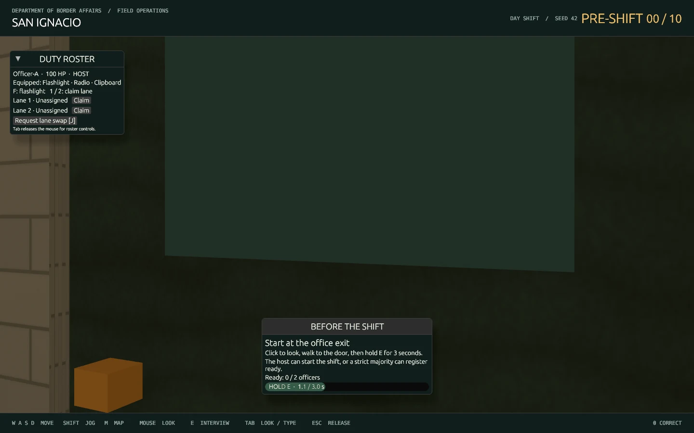
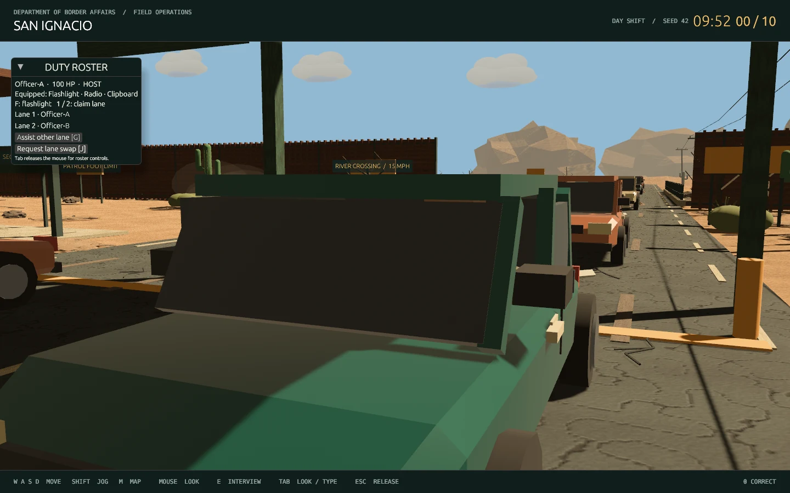

# Part 5 — Shared office, ready door and host clock

Normal play now joins a real host session. Both officers spawn inside the administration office with 100 health and a pistol, flashlight, radio and clipboard. The exit stays closed, the clock stays at ten minutes, and vehicle queues/security scheduling stay inactive until the ready condition passes.

## Start and join

From the repository root:

```sh
./play.sh --name=Officer-A
```

For a second local client, use another terminal before starting the shift:

```sh
./play.sh --join --name=Officer-B
```

Windows equivalents:

```powershell
.\play.ps1 --name=Officer-A
.\play.ps1 --join --name=Officer-B
```

The launcher starts the provider gateway and authoritative host, creates a temporary invite, and records local join information in ignored `output/local-session.json`. On Linux that file is restricted to the current user. A local second client reuses the running speech service. Join mode does not start or stop the first player's host/gateway. Closing the hosting launcher ends that session; seamless reconnect/host handoff remains later work.

For a trusted LAN session, the host can explicitly listen beyond loopback:

```sh
BORDER_HOST_BIND=0.0.0.0:8090 ./play.sh --name=Officer-A
```

The host terminal prints an invite code. On the other computer, substitute the host's LAN address and that code:

```sh
BORDER_HOST_JOIN_CODE=INVITE-CODE ./play.sh --join=http://192.168.1.10:8090 --name=Officer-B
```

Set the same environment variables in PowerShell for Windows. The development transport uses HTTP; Internet matchmaking, encryption and reconnect hardening remain later milestones. Joining an already active shift is deferred, so join in the office lobby. The session accepts exactly **two players and two lanes**.

## Ready up and work

1. Click the scene to look, then use WASD to approach the office exit. Left Shift jogs.
2. Hold **E** near the closed door. The visible bar measures three seconds of fresh, continuous input validated by the host. Releasing early, walking away or losing communication cancels an incomplete hold.
3. The host completing the hold starts the shift. Alternatively, a strict majority of connected officers may register ready. With two officers, a lone guest vote is insufficient. A completed guest vote persists until withdrawn.
4. The door opens for everyone, the host starts the **600,000 ms** countdown, and the queues and security-event scheduler activate together. Both screens show time from host snapshots; changing focus or releasing the mouse does not pause the shift.
5. Claim a free lane with **1** or **2**, or use the duty roster after pressing Tab to release the mouse. Claiming a free lane releases your previous one. Both are assigned automatically on shift start if still free.
6. Press **J** to request a swap. The other officer presses J or clicks **Accept lane swap**; ownership changes atomically only after acceptance. Press **G** to assist the other staffed lane, or stop assisting. An assistant can approach that driver, share the conversation/evidence and help process the same case.
7. Aim at a stopped car within interview range and press **E**. Questions, answers, observed evidence and committed outcomes are shared host state. The existing microphone/text interface and AI personalities remain available. Only one response request may be pending per traveler.
8. Close the committed case file to release the vehicle. The host advances its lane while the other lane can continue independently. Duplicate decisions cannot award twice.

**F** toggles the equipped flashlight. **M** opens the site map. **Tab** switches look/UI input; **Escape** releases the mouse. The roster shows health, loadout, lane ownership and radio notices. Player positions and visible officer markers come from the host.

At zero, the clock stays at zero, fresh arrivals pause, and already stopped drivers may be finished. The host can prepare another shift after expiry or when the authored pack is exhausted. Officers return to the office healed, ready votes clear, the door closes and queues pause. Full financial settlement/review is still a later Part.

## What is authoritative

- The protocol is now **version 4**. Clients send movement direction, looking yaw, jogging intent and a held-ready input flag; they cannot submit coordinates, hold duration, elapsed shift time, readiness completion or rewards.
- The host measures time using its own monotonic clock, checks doorway range and input freshness, applies the three-second threshold, validates the host/majority rule and publishes the shared transition.
- Input frames are monotonic and stay replay-protected across shift resets. Timed-out commands retry the same request identity; snapshots also acknowledge the accepted command sequence.
- Static collision comes from the committed scene export, plus the host's dynamic ready-door/vehicle rules. A regression test compares the bake with the actual rendered scene. Positions freeze when communication is lost.
- Both lanes' vehicles, interview history, evidence, decisions and ledger are host-owned. The graphical client no longer loads scenario truth for normal play. The gateway gets private case context through a separate service credential and validates replies before host delivery.
- Replies carry a case epoch, preventing an old in-flight AI response from entering a newly reset shift. Pending request guards also clean up on cancellation.

The radio/security scheduler activates with the shift and emits deterministic seeded dispatch hooks. Current visible events are radio checks and perimeter/queue notices; this milestone does not implement combat, fleeing NPCs or breach encounters.

## Validation and practical limits

Validated on the Linux desktop:

- Locked workspace tests, Clippy with warnings denied, and formatting pass.
- `python3 scripts/test_host.py` starts real services and two authenticated peers. It rejects fake time/position input, checks incomplete/stale/remote holds, guest readiness, host override, exact ten-minute expiry, two lanes, consented swaps, assisted AI/evidence, idempotent decisions, radio activation and reset.
- `python3 scripts/test_graphical_shift.py` runs **two actual Bevy processes** against the same host. They spawn in the shared office, complete the ready-door flow, show the same host-start timestamp/countdown, see shared officers/vehicles, and complete an interview plus inspection. It saves ready/active captures and public state under ignored `output/`.
- The normal launcher was exercised through `./play.sh --smoke-shift`. Automated render/interview tests disable recording and speech playback and use offline AI, avoiding paid model requests.

Windows scripts/CI are updated, but a Windows desktop run has not been verified here. These are development snapshots, simple officer markers and basic vehicle paths; interpolation, reconnect, animation polish, spatial speech playback and the entire 20-step multiplayer acceptance run remain Part 15. Truck/interaction variants remain Part 6. No RTX 2060 performance certification is implied.





Part 6 adds physical `inspect_vehicle_point` commands, shared inspected-panel state, a vehicle-size catalog and separate entry/exit gate state. See [vehicle lifecycle and controls](VEHICLES.md).

Protocol 4 adds authoritative pistol/projectile state, door/window commands, physical traveler exit/return, damage and disabled-vehicle recovery. See [combat and vehicle mechanics](COMBAT.md).
