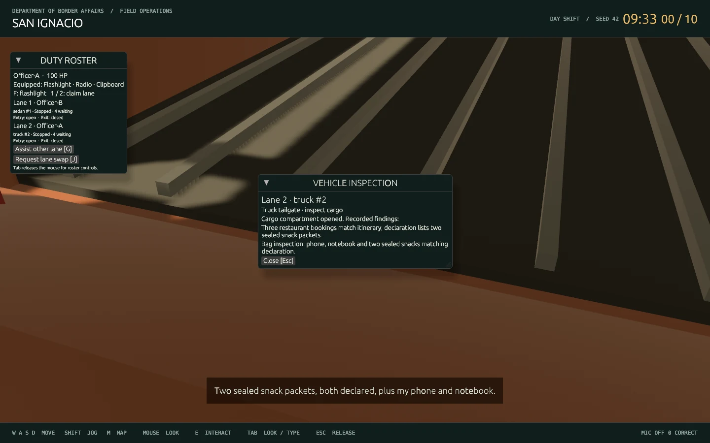

# Part 6 — Two-lane vehicle lifecycle

Normal play has exactly two independently staffed inspection lanes. Each receives both sedans and pickup trucks, driven by the host rather than a local animation. The ten existing travelers are assigned alternately across the lanes; the repeating vehicle schedule is sedan, truck, truck, sedan. Vehicle appearance is independent of whether a traveler is honest.

## Play

```sh
./play.sh
# Another terminal, before ready-up:
./play.sh --join --name=Officer-B
```

Hold E at the office ready door for two seconds. Claim or assist a lane using the roster. Approach a stopped vehicle and point at an interactable object; its white outline marks the E target. [Current conversation/interaction controls](CONVERSATION.md) supersede the original automatic panels described below:

- **Driver window:** opens the existing text/continuous-microphone conversation. Speech remains automatic during an open interview. Walking away or closing the interview pauses microphone capture; approaching the window and reopening the conversation resumes it.
- **Passenger door:** opens the door panel and records cabin access. This does not declare the traveler innocent or reveal cargo evidence.
- **Hood:** raises the hood and records engine-bay access. It does not establish legal status or invent scenario evidence.
- **Trunk / pickup tailgate:** opens the relevant panel and records the existing authored secondary-inspection findings in the shared case. Both officers see the same evidence.

Stand within two metres of the indicated access position and aim at the window/panel. The host checks actual position, stopped state and lane ownership/assistance before accepting an interaction. Queued, departing and resolved vehicles cannot start new conversations or physical inspections. Press Escape to close an inspection; Tab or a click in the world restores mouse look.

The existing interview Admit/Deny controls remain available for exercising departures. Confirm the outcome, then close the case to release the vehicle. The fuller inspection/decision workflow remains Part 10. The older interview secondary-search shortcut remains a prototype route alongside the new physical cargo interaction; object-by-object searches are later work.

## Vehicles and access

The shared catalog is `crates/net/src/vehicle.rs`; it defines footprints, four access positions, aiming positions, queue clearance and departure waypoints. The renderer and host use the same dimensions:

| Vehicle | Collision width × length | Visible model | Cargo access |
| --- | --- | --- | --- |
| Sedan | 2.16 × 4.60 m | Existing chamfered painted body, sloped glazing, driver, wheels and metal trim; articulated hood, trunk and passenger panel | Rear trunk |
| Pickup truck | 2.34 × 6.60 m | Raised cab, open driver window, seated driver, long ribbed bed, bed rails, running boards, mirrors, grille, bumpers, lights and larger wheels | Rear tailgate |

Both types use the same reusable queue/departure controller. Public snapshots specify the model kind, pose, speed, lifecycle stage, inspected panels and observed evidence. Client meshes do not choose truth, destinations, queue positions or barrier state. Panels close when the vehicle leaves inspection. The catalog and panel animation are deliberately small and reusable for later vehicle types; SUVs, vans, semis and advanced inspection tools are outside this milestone.

## Lane and motion rules

Each lane has an entry gate at +16 m and an exit gate at −5.8 m relative to its inspection stop. The exit was moved back to fit the pickup's longer nose. Entry gates lift before a body reaches them and stay open while it occupies their clearance; exit gates lift for released vehicles and remain raised until their rear clears. Closed bars also block officers; use the clear side paths to walk around them.

The lifecycle is queued → stopped → resolved → departing → exited. Vehicles accelerate, brake and stop at the lane's zero point. Following distances use **both vehicles' half-lengths plus three metres of bumper clearance**, including while the preceding vehicle begins departing. A queued pickup therefore receives more space than a sedan. Incoming and departing vehicles yield to an officer in their forward safety envelope, sized to their actual body.

Admitted vehicles continue north and follow the existing road's distant bend. Denied vehicles clear the stop and turn west onto the return road. Both routes end beyond the visible checkpoint. A lane advances as its departing vehicle clears the stop; it does not wait for the other lane's interview. Straight departures can run together. Departures whose paths intersect the westbound return merge reserve that short conflict area in release order, then free it after clearing the junction. The two lanes retain separate owners, queues and gate state throughout.

At clock expiry, already stopped vehicles may finish and depart; new arrivals freeze. Reset clears gate and inspection state along with the rest of the shift. No additional lanes or compound fences are introduced.

## Validation

```sh
cargo test --locked --workspace
cargo clippy --locked --workspace --all-targets -- -D warnings
cargo fmt --all -- --check
python3 scripts/test_host.py
python3 scripts/test_graphical_shift.py --lifecycle
```

The locked Rust suite passes **57 tests**, with one existing microphone/model fixture ignored; Clippy and formatting pass. The simulation tests check mixed-length bumper gaps, both gate pairs, physical inspection permissions/range, repeated inspection idempotency, rotated access positions, pickup-sized pedestrian yielding, independent next-car advancement, and all ten vehicles reaching the ends of the admit/deny roads. The HTTP check exercises both first vehicles, rejects remote/other-lane cargo access, shares physical evidence, releases both routes and verifies that both next vehicles stop.

The Linux graphical check starts two actual Bevy clients with a local offline AI gateway. Both walk out of the office, select their driver window using the normal interaction targeting code, complete an interview, walk to the rear cargo point and inspect it. It captures the sedan trunk and truck tailgate after host confirmation. Recording and voice playback are disabled in this automated check; it makes no paid AI requests. This is automated desktop acceptance, not a human playtest or RTX 2060 performance certification. Windows desktop operation remains unverified.



The subsequent [combat/vehicle interaction update](COMBAT.md) adds functioning front doors and side windows, transparent/destructible glazing, physical driver exit/return/death, pistol projectiles and recovery. Its current controls supersede the original cosmetic panel behavior described above.

The [subsequent vehicle/physics pass](PHYSICS.md) expands the catalog to sedan, pickup, SUV, van, hatchback and utility pickup, with more close-up fittings, shared predicted movement and real rigid-body occupants/glass.
